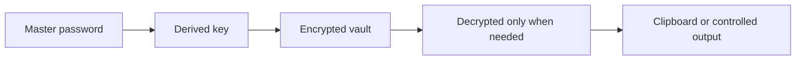

# Password Manager

<div align="center">  </div>

A Python security project for learning how password storage, encryption boundaries, and local credential workflows should be designed.

## Security model



## Important

This repository is educational. Do not use it as a production password manager without a serious security review, audited cryptography, secure key handling, and protected backups. Never commit real credentials.

## Getting started

```bash
python -m venv .venv
.venv\Scripts\activate
pip install -r requirements.txt
python main.py
```

Use test data only while experimenting.
